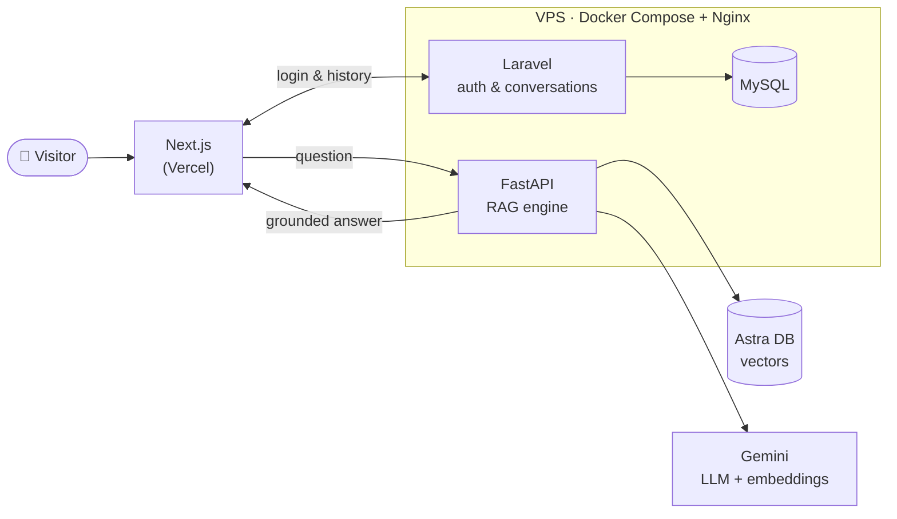

<div align="center">
  
</div>

<p align="center">
  <a href="https://linkedin.com/in/muhamad-safii-eko-kuncoro-b8053731b"></a>
  <a href="mailto:firelord@gmail.com"></a>
  
  
</p>

---

## 📦 Release notes

> **v1.0.0 — "Fresh Graduate"**
> Information Systems graduate who ships full-stack web apps and enjoys the backend side most: APIs, databases, and the plumbing that makes an app reliable.

| | |
|---|---|
| **Role** | Junior Web Developer (Backend-leaning, Fullstack-capable) |
| **Education** | B.Sc. Information Systems, Universitas Gunadarma — Class of 2026 |
| **Core stack** | PHP · Laravel · React / Next.js · MySQL · REST API |
| **Currently learning** | Go · REST API security · cloud microservices |
| **Principle** | Clean code beats clever code |

---

## 🗒️ Changelog

### `[Unreleased]` — what I'm looking for
- 🎯 My first role as a **Junior Web Developer** (backend or fullstack) on a team where I can learn from experienced engineers and ship real features.

### `[1.0.0]` — 2026 · Graduated
**Added**
- 🎓 Graduated in Information Systems, Universitas Gunadarma.
- 🧠 Defended my thesis: a **RAG-based chatbot for a hospital website (RSU Aulia)**, evaluated with the **RAGAS** framework across six metrics.
- 🏗️ Deployed a multi-service system with Docker Compose behind Nginx.

**In progress**
- 🌴 **[Jelajah Tangerang](https://github.com/ekodee)** — a local tourism and culinary discovery platform (Laravel + React).
- 🐹 Self-study in **Go**, to broaden my backend toolbox.

### `[0.x]` — student years
- Built web projects with Laravel, React.js, and MySQL, and practiced a Git/GitHub workflow along the way.

---

## 🚀 Featured project: RAG chatbot for RSU Aulia

A website chatbot that answers questions from hospital information using Retrieval-Augmented Generation. The system is split into small services, each with one job.



<details>
<summary><b>Why it's built this way</b></summary>

- **FastAPI** owns the RAG pipeline (LangChain, retrieval, generation) and has no direct MySQL connection.
- **Laravel** owns authentication and conversation history, keeping business data in MySQL.
- **Next.js** talks directly to FastAPI for answers, so the chat stays fast.
- **RAGAS** evaluation measured answer quality across six metrics, using 20 evaluation scenarios.

</details>

---

## 🧰 Stack

```json
{
  "name": "muhamad-safii",
  "version": "1.0.0",
  "role": "junior-web-developer",
  "dependencies": {
    "backend":  ["PHP 8", "Laravel 11", "FastAPI", "REST API", "JWT"],
    "frontend": ["JavaScript (ES6+)", "React.js", "Next.js", "Tailwind CSS", "Bootstrap 5"],
    "database": ["MySQL", "Astra DB (vector)"],
    "ai":       ["LangChain", "Gemini", "RAGAS"]
  },
  "devDependencies": ["Git", "GitHub", "Docker Compose", "Nginx", "Postman", "VS Code"],
  "learning": ["Go", "REST API security", "Cloud microservices"]
}
```

<!--
  OPTIONAL: contribution snake.
  1) Enable the workflow in .github/workflows/snake.yml and run it once from the Actions tab.
  2) Then remove this comment wrapper.

---

<div align="center">
  <picture>
    <source media="(prefers-color-scheme: dark)" srcset="https://raw.githubusercontent.com/ekodee/ekodee/output/github-snake-dark.svg" />
    <source media="(prefers-color-scheme: light)" srcset="https://raw.githubusercontent.com/ekodee/ekodee/output/github-snake.svg" />
    
  </picture>
</div>
-->

---

## 🤝 Let's talk

I'm open to junior web developer and backend opportunities. If you're hiring, mentoring, or just want to talk Laravel, APIs, or RAG, feel free to reach out.

<p align="center">
  <a href="https://linkedin.com/in/muhamad-safii-eko-kuncoro-b8053731b"><b>LinkedIn</b></a> ·
  <a href="mailto:firelord@gmail.com"><b>Email</b></a> ·
  <a href="https://github.com/ekodee"><b>GitHub</b></a>
</p>

<p align="center"><sub><code>git commit -m "ready for the first real job" 🚀</code></sub></p>
